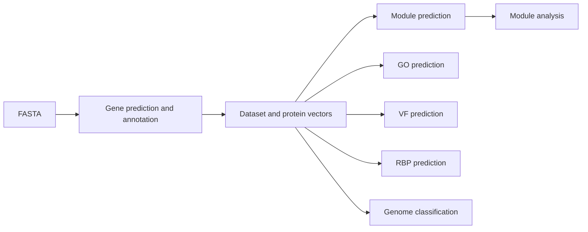

# Code structure

The Python package is in `src/phanet/`.

| Module | Purpose |
|---|---|
| `cli.py` | Parse command-line arguments and dispatch commands |
| `annotation.py` | Run gene prediction and traditional annotation |
| `inference.py` | Coordinate network and GLM prediction and export results |
| `datasets/` | Read sequences, store genome/protein records and build datasets |
| `representations/` | Compute and store ESM2 and TM-Vec protein vectors |
| `network/` | Search reference proteins, build graphs and propagate annotations |
| `learning/` | Genomic-context model, batching and training |
| `downstream/` | Module, GO, VF, RBP and taxonomy interfaces |
| `analysis/` | Compare predicted modules with references and group them across genomes |
| `common/` | File I/O, checksums and shared constants |
| `resources.py`, `resource_setup.py`, `tool_setup.py` | Download and configure databases, models and command-line tools |

`configs/` contains configuration examples, `examples/` contains sample inputs
and commands, `tests/` contains automated tests, and `docs/` contains user guides.

For custom inputs, `datasets/importing.py` creates genome/protein records,
`network/build.py` builds inference reference packages, and `learning/data.py`
prepares and loads GLM training datasets. See [custom data](custom-data.md).

## Processing flow

`annotate` reads nucleotide FASTA, calls `annotation.py` to prepare proteins and
annotations, then uses `inference.py` to run the selected prediction method.
`representations/` supplies protein vectors, `network/` supplies reference-based
scores, and `learning/` supplies the context model. Results are exported as
TSV, GFF3 and FASTA files.

The downstream commands reuse the prepared dataset and embeddings.
`discover-modules` runs module prediction followed by analysis;
`analyze-modules` starts from existing predictions. RBP and taxonomy commands
accept native datasets or nucleotide FASTA. `downstream/native.py` encodes
protein contexts, `native_train.py` fits task heads, and `native_predict.py`
writes predictions. `learning/run.py` handles GLM training and model export.

## Workflow

See the [Python API](api.md) for calls, arguments, return values and output paths.
